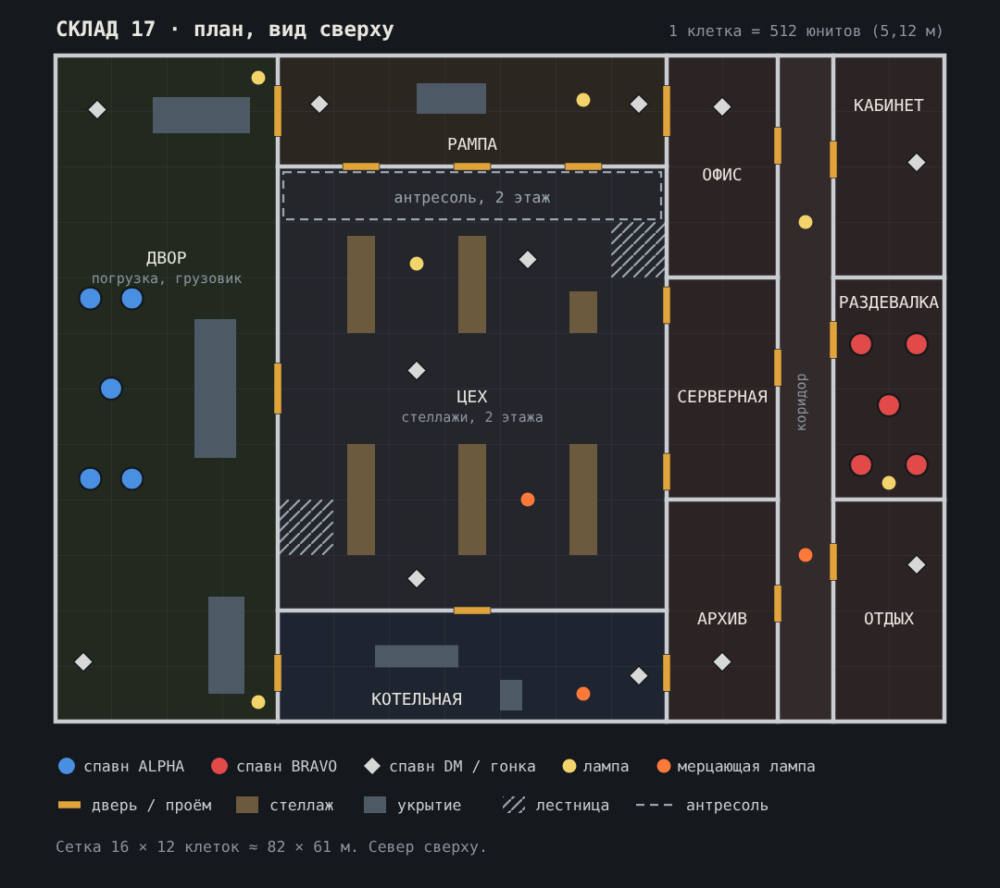

# Карта «Склад 17»

Ночной склад на окраине: двор с фурами, рампа погрузки, двухэтажный цех со стеллажами, тесная котельная и офисный блок. Одна карта подходит для всех трёх режимов: «Раунды» 5 на 5, Deathmatch и «Гонка вооружений» (до 12 игроков).

Исходник схемы: [map_warehouse17.svg](map_warehouse17.svg).

> Файл уровня UEFN (.umap) собирается только в самом редакторе. Этот документ служит чертежом, по которому карта собирается за вечер.

## Сетка и координаты

- 1 клетка = 512 юнитов (стандартная клетка Fortnite, 5,12 м). Высота этажа 384 юнита.
- Карта 16 × 12 клеток ≈ 82 × 61 м.
- Координаты ниже отсчитываются от северо-западного угла карты: **X на восток, Y на юг**. Поставьте этот угол в удобную точку уровня и прибавляйте смещение. Если в вашей сцене оси направлены иначе, поменяйте знак.

## Зоны

| Зона | Клетки (X, Y) | Высота | Роль в бою |
|---|---|---|---|
| **Двор** | 0–3, 0–11 | улица | Спавн ALPHA. Открытое пространство под натриевыми фонарями. Фура и контейнеры служат укрытиями, через двор долго и опасно бежать |
| **Рампа** | 4–10, 0–1 | 1 этаж, навес | Северный обход между двором и офисами. Три рольставни ведут в цех. Длинная простреливаемая линия |
| **Цех** | 4–10, 2–9 | 2 этажа (768) | Центр карты. Три ряда стеллажей с поперечным проходом посередине. Над северной стеной антресоль: высота с видом на весь цех |
| **Антресоль** | 4–10, 2 | второй ярус (+384) | Металлический настил с перилами. Лестницы в клетках (10, 3) и (4, 8) |
| **Котельная** | 4–10, 10–11 | 1 этаж, низкий потолок | Южный обход. Трубы, бойлер, почти без света, ближний бой |
| **Офис** | 11–12, 0–3 | 1 этаж | Столы, перегородки |
| **Серверная** | 11–12, 4–7 | 1 этаж | Ряды серверных стоек, синий свет индикаторов. Два входа из цеха |
| **Архив** | 11–12, 8–11 | 1 этаж | Стеллажи с коробками, выход в котельную |
| **Коридор** | 13, 0–11 | 1 этаж | Хребет офисного блока, лампы дневного света |
| **Кабинет** | 14–15, 0–3 | 1 этаж | Тупиковая комната с одним входом: место для засады, но и ловушка |
| **Раздевалка** | 14–15, 4–7 | 1 этаж | Спавн BRAVO. Шкафчики, скамейки |
| **Отдых** | 14–15, 8–11 | 1 этаж | Диван, автомат с кофе, мерцающая лампа |

Двери и проёмы показаны на схеме оранжевым. Ширина каждого проёма 1 клетка, рольставни рампы тоже по 1 клетке.

## Маршруты и баланс

От обоих спавнов до центра цеха примерно одинаково: около 6 клеток.

- **Север** (рампа): быстрый, но открытый. Длинная линия от двора до офисов.
- **Центр** (цех): стеллажи режут линии обзора, антресоль даёт высоту, но с неё видно стрелка.
- **Юг** (котельная): тёмный, медленный, бой на дистанции 2–5 м.

ALPHA выходит со двора через три точки: рампу, ворота в цех (клетка Y 5–6) и котельную. BRAVO выходит из офисов через рампу, серверную (два входа) и котельную. Длинных сквозных линий через всю карту нет: стеллажи и стены режут каждую на отрезки не длиннее 4–5 клеток.

## Точки спавна

### «Раунды» 5 на 5

Player Spawner, Team 1 и Team 2.

| ALPHA (двор) | BRAVO (раздевалка) |
|---|---|
| (320, 2240) | (7424, 2656) |
| (704, 2240) | (7936, 2656) |
| (512, 3072) | (7680, 3232) |
| (320, 3904) | (7424, 3776) |
| (704, 3904) | (7936, 3776) |

Поверните спавны ALPHA на восток, BRAVO на запад.

### Deathmatch и «Гонка вооружений»

12 Player Spawner, Team: Any, разнесены по всей карте:

| # | Где | X, Y |
|---|---|---|
| 1 | двор, север | (384, 496) |
| 2 | двор, юг | (256, 5600) |
| 3 | рампа, запад | (2432, 448) |
| 4 | рампа, восток | (5376, 448) |
| 5 | цех, центр | (3328, 2912) |
| 6 | цех, северо-восток | (4352, 1888) |
| 7 | цех, юг | (3328, 4832) |
| 8 | котельная | (5376, 5728) |
| 9 | офис | (6144, 480) |
| 10 | архив | (6144, 5600) |
| 11 | кабинет | (7936, 992) |
| 12 | отдых | (7936, 4704) |

Чтобы не появляться под стволом у соперника, включите в спавнерах опцию выбора спавна подальше от врагов (если она есть в вашей версии) или используйте больше точек.

## Свет

Свет здесь важнее геометрии: им вы определяете, где опасно.

| Источник | X, Y | Тип |
|---|---|---|
| Фонарь двора, север | (1872, 208) | натриевый, тёплый жёлто-оранжевый, сильный |
| Фонарь двора, юг | (1872, 5968) | натриевый |
| Рампа | (4864, 416) | лампа над рольставнями |
| Цех, у антресоли | (3328, 1920) | промышленный подвесной светильник, узкий конус вниз |
| Коридор, север | (6912, 1536) | лампа дневного света, холодная |
| Раздевалка | (7680, 3936) | лампа дневного света |
| **Мерцает:** цех, юго-восток | (4352, 4096) | подвесной, гаснет на 0,1–0,5 с |
| **Мерцает:** котельная | (4864, 5888) | тусклая лампа в сетке |
| **Мерцает:** коридор, юг | (6912, 4608) | лампа дневного света с «стартерным» миганием |

Всё остальное должно быть тёмным. Луна слабая (0,1–0,3) и холодная. Серверную подсветите синими индикаторами (несколько слабых точечных источников) и больше ничем.

Мерцание собирается так: Customizable Light и Timer (1,7 с, повтор). Таймер переключает свет, второй таймер со сдвигом на 0,2 с возвращает его.

## Сборка в UEFN

1. **Геометрия.** Соберите стены и полы по сетке из стандартных строительных галерей: стены, полы, лестницы и перила для антресоли. Подойдут промышленные и складские галереи (стены из профлиста и бетона, металлические настилы). Офисы собираются из офисных галерей или обычных гипсовых стен.
2. **Крыша.** Над цехом, рампой, котельной и офисами крыша обязательна: без неё в помещения попадает лунный свет и пропадает темнота. Двор открытый.
3. **Укрытия** (серые блоки на схеме): фура и контейнеры во дворе, поддоны на рампе, бойлер и трубы в котельной. Стеллажи цеха высотой в 1 этаж. Сквозь них должно быть видно силуэт, но не прострел.
4. **Детали.** Коробки, поддоны, мусор, кабели, огнетушители, плакаты по технике безопасности. Реалистичные ассеты можно взять на Fab, если позволяет бюджет памяти острова.
5. **Звук окружения.** Гул вентиляции в цехе, капающая вода в котельной, жужжание ламп в коридоре, далёкая трасса во дворе. Используйте Audio Player с небольшим радиусом.
6. **Спавны и устройства** по таблицам выше и по [SETUP.md](SETUP.md).
7. **Туман**: Exponential Height Fog, объёмный, в цехе особенно заметен в лучах ламп.

## Чек-лист карты

- [ ] Из любого спавна нельзя простреливать чужой спавн.
- [ ] В каждом помещении минимум 2 выхода (кабинет — сознательное исключение).
- [ ] Самая длинная линия обзора не длиннее 5 клеток (около 25 м).
- [ ] Есть по-настоящему тёмные углы и есть освещённые простреливаемые зоны.
- [ ] Все двери проходимы, лестницы на антресоль не цепляют персонажа.
- [ ] Бюджет памяти острова в норме: индикатор Memory в UEFN не в красной зоне.
