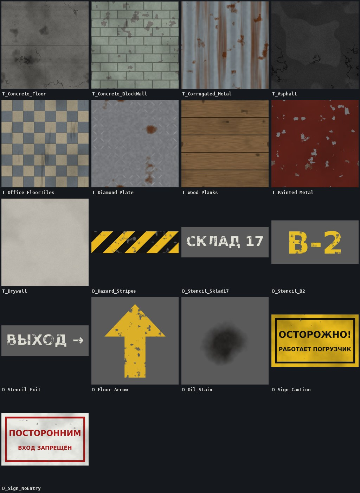

# Текстуры для «Склада 17»



Все текстуры бесшовные и сгенерированы скриптом [`tools/generate_textures.py`](../tools/generate_textures.py) с нуля, без чужих ассетов, так что их можно свободно использовать на острове. Разрешение 1024×1024. Для 2K выполните:

```
python3 tools/generate_textures.py --size 2048
```

Нужны Python 3, numpy и Pillow. Параметр `--seed` даёт другие варианты рисунка.

## Материалы (`textures/materials/`)

У каждого материала три карты:

| Суффикс | Что это | Настройки импорта в UEFN |
|---|---|---|
| `_BaseColor.jpg` | цвет | sRGB: On, Compression: Default |
| `_Normal.png` | нормали в формате DirectX (как в Unreal) | sRGB: Off, Compression: Normalmap |
| `_Roughness.jpg` | шероховатость | sRGB: Off, Compression: Masks (или Grayscale) |

| Материал | Где использовать | Площадь одной текстуры | Tiling для стены/пола 512×512 |
|---|---|---|---|
| `T_Concrete_Floor` | пол цеха, рампы, котельной | 4×4 м | 1.28 |
| `T_Concrete_BlockWall` | стены цеха и котельной | 2×2 м | 2.56 |
| `T_Corrugated_Metal` | наружные стены, рольставни, навес рампы | 2×2 м | 2.56 |
| `T_Asphalt` | двор | 4×4 м | 1.28 |
| `T_Office_FloorTiles` | пол офисов и коридора | 2,4×2,4 м | 2.13 |
| `T_Diamond_Plate` | антресоль, лестницы | 1×1 м | 5.12 |
| `T_Wood_Planks` | поддоны, ящики, полки стеллажей | 1×1 м | 5.12 |
| `T_Painted_Metal` | контейнеры, котёл, шкафчики раздевалки | 2×2 м | 2.56 |
| `T_Drywall` | стены офисов | 2×2 м | 2.56 |

## Декали (`textures/decals/`)

PNG с прозрачностью и потёртостями.

| Декаль | Где |
|---|---|
| `D_Hazard_Stripes` | края рампы, низ колонн, проёмы ворот. Тянется по горизонтали |
| `D_Stencil_Sklad17` | фасад и ворота цеха со стороны двора |
| `D_Stencil_B2` | колонны и стены цеха (сделайте копии с другим текстом в скрипте: B-1, B-3) |
| `D_Stencil_Exit` | стены коридора офисов |
| `D_Floor_Arrow` | разметка на полу цеха и рампы |
| `D_Oil_Stain` | пятна на бетоне и асфальте, особенно у ворот и под фурой |
| `D_Sign_Caution` | «ОСТОРОЖНО! РАБОТАЕТ ПОГРУЗЧИК»: цех, рампа |
| `D_Sign_NoEntry` | «ПОСТОРОННИМ ВХОД ЗАПРЕЩЁН»: двери офисов, серверная |

## Подключение в UEFN

### 1. Импорт

1. Content Browser → создайте папку `Textures/Warehouse17`.
2. Перетащите туда файлы из `textures/materials/` и `textures/decals/`.
3. Для каждой `_Normal` откройте текстуру и проверьте Compression Settings = Normalmap. Обычно UEFN ставит это сам по суффиксу.
4. Для `_Roughness` выключите sRGB.

### 2. Мастер-материал (один на все поверхности)

Создайте материал `M_Warehouse_Master`:

```
TexCoord ─► Multiply (ScalarParameter "Tiling" = 1) ─┬─► TextureSampleParameter2D "BaseColor" ─► Multiply (VectorParameter "Tint" = 1,1,1) ─► Base Color
                                                     ├─► TextureSampleParameter2D "Normal"    ─► Normal
                                                     └─► TextureSampleParameter2D "Roughness" ─► Multiply (ScalarParameter "RoughnessScale" = 1) ─► Roughness
ScalarParameter "Metallic" = 0 ─► Metallic
```

Для металлов (`T_Corrugated_Metal`, `T_Diamond_Plate`) поставьте Metallic около 0.7. Для крашеного металла оставьте 0.2: краска не металл.

Затем на каждую текстуру сделайте **Material Instance** (`MI_Concrete_Floor` и т.д.): подставьте три карты и Tiling из таблицы выше.

> Если UV у модулей галерей неудобные, возьмите вместо TexCoord узел **WorldAlignedTexture** с размером текстуры в юнитах (например, 400 для 4 м). Тогда рисунок не будет растягиваться на стенах разной длины.

### 3. Материал декалей

Создайте `M_Warehouse_Decal`:
- Material Domain: Deferred Decal, Blend Mode: Translucent.
- Texture Sample (декаль): RGB ─► Base Color, A ─► Opacity.
- Roughness: 0.8 для краски, 0.3 для `D_Oil_Stain` (масло блестит).

Сделайте Material Instance на каждую декаль и разместите их через **Decal Actor**. Если Decal Actor недоступен в вашей версии UEFN, наложите декаль на тонкую плоскость (Plane) с материалом в Blend Mode: Masked.

### 4. Применение

1. Выделите стены или пол → Details → Materials → назначьте нужный `MI_...`.
2. У модулей галерей Fortnite часто несколько слотов материала. Меняйте основной слот (стена или пол), а слоты рамок и краёв можно оставить.
3. Чтобы убрать повторяемость:
   - чередуйте Tint в инстансах (±5% яркости);
   - добавьте сверху декали масла, разметки и табличек;
   - на больших плоскостях (пол цеха) немного сдвигайте UV через WorldAlignedTexture.

## Почему такие текстуры подходят для бодикама

Тёмная сцена, зерно и низкая чёткость «камеры» съедают мелкие детали. Поэтому в текстурах сделан упор на крупный контраст: пятна, подтёки, швы, разметку. Блеск тоже работает на атмосферу: мокрый асфальт и масляные пятна (низкий Roughness) ловят свет фонарей. Это сильно добавляет реализма в кадре.
